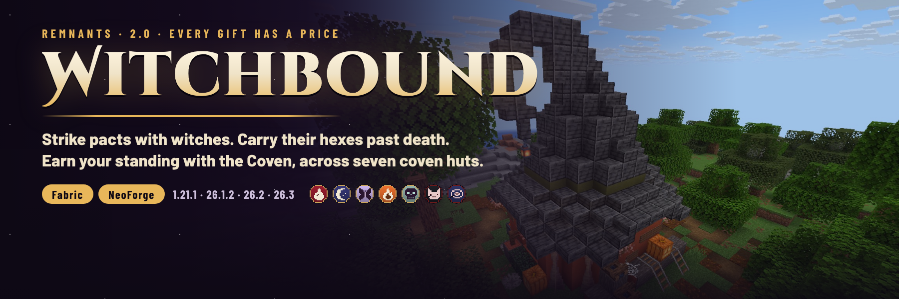

# Witchbound



A witchcraft RPG for Minecraft, formerly **The Witch Hut**. Its systems:
- **Pacts:** strike a bargain with a witch, keep the gift and pay the price for good.
- **Hexes:** curses that follow you past death until you break them.
- **Coven Standing:** earn your place with the witches of the world.
- **Seven coven huts**, each with a resident witch.

Listed as **Remnants | Witchbound**.

**2.0 "Every Gift Has a Price"** rebuilds the mod. See:
- the [2.0.0 notes](patchnotes/2.0.0.md)
- the [design notes](docs/DESIGN-2.0.md)
- the [market analysis](docs/market-analysis.md), which covers why this mod and which RPG mods don't exist yet
- the [QA record](docs/QA-2.0.0.md)

## Which jar do I download?

Jar names are `better_witch_huts-{loader}-{minecraft}-{modVersion}.jar`. Match **both** the Minecraft version and the
loader.

| Minecraft | Java | Fabric jar (needs Fabric API) | NeoForge jar |
|-----------|------|-------------------------------|--------------|
| 1.21.1 | 21+ | `…-fabric-1.21.1-2.0.0.jar` | `…-neoforge-1.21.1-2.0.0.jar` (NeoForge 21.1.219 or newer) |
| 26.1.2 | 25+ | `…-fabric-26.1.2-2.0.0.jar` | `…-neoforge-26.1.2-2.0.0.jar` (NeoForge 26.1.2.7-beta or newer) |
| 26.2 | 25+ | `…-fabric-26.2-2.0.0.jar` | `…-neoforge-26.2-2.0.0.jar` (NeoForge 26.2.0.93 or newer) |
| 26.3 | 25+ | `…-fabric-26.3-2.0.0.jar` | `…-neoforge-26.3-2.0.0.jar` (NeoForge 26.3.0.97 or newer) |

Install it on the server and on clients. No other library is needed (1.0 required an undeclared one; 2.0 does not).

## Features

### Seven coven huts

| Structure id | Name | Where | Resident |
|---|---|---|---|
| `witch_hut` (unchanged) | The Old Hut | plains, sunflower plains, forests, birch forests | Granny Hollowell |
| `bog_hut` | Bog Hut | swamps | Old Mother Mirewort |
| `mangrove_roost` | Mangrove Roost | mangrove swamps | Auntie Silt |
| `hedge_cottage` | Hedge Cottage | meadows, flower forests, cherry groves | Hedgewife Tansy |
| `nightshade_circle` | Nightshade Circle | dark forests, pale gardens | Mother Nightshade |
| `rime_hut` | Rime Hut | snowy taigas, snowy plains, groves | Frostwife Isolde |
| `bone_hut` | Bone Hut | badlands, deserts | Crone Ossia |

- **Placement:** before a hut is placed, the land is sampled at its footprint in every rotation. Land huts need level
  ground, swamp huts need shallow water or mud, and huts keep 4 chunks from villages.
- **Loot:** every chest draws from the hut's loot table; barrels draw from `chests/hut_storage`.
- **Residents** (`better_witch_huts:coven_witch`):
  - never despawn and never join raids
  - fight only a player who strikes them, or whom the Coven hunts
  - right-click one to open the **Coven screen**

### Pacts

- Each resident offers three of the twelve pacts each in-game day.
- **Strike** one to keep its Gift and pay its Price permanently.
- Pacts survive death and milk; a resident undoes one for 24 emeralds and −5 standing.
- Slots by tier: Stranger and Known 1, Trusted 2, Kin 3.
- The list: Leech, Night Hunter, Toad, Stoneskin, Hare, Magpie, Witchfire, Moth, Wolf, Briar, Raven, Undying. The numbers
  are in [DESIGN-2.0.md](docs/DESIGN-2.0.md#pacts-every-gift-has-a-price).

### Hexes

- **Where they come from:** hostile witches, and residents who are fighting you, channel a hex at a player for 1.5 s.
  Hitting the witch breaks the spell. The chance is 35 %, plus 15 % at night and 25 % more under a full moon.
- **Limit:** a player carries at most three.
- **Persistence:** they survive death and milk.
- **Breaking one:**
  - do its task, read from vanilla statistics: swim, sprint, eat, fish, ring bells, trade, slay, place candles, breed,
    eat a golden apple, mine or chop
  - smash a **Witch Bottle**
  - pay a resident
- **Protection:** a **Poppet** catches the next hex cast at you.
- The eight hexes: Leaden Limbs, Gnawing Hunger, Black Cat, Brittle Bones, Withering Grip, Insomnia, Frail Heart, Clumsy
  Fingers.

### Coven Standing

- Standing runs from −100 to 100, in six tiers: Hunted, Distrusted, Stranger, Known, Trusted, Kin. The tier sets pact
  slots, the price of lifting a hex, whether Poppets are for sale, and whether residents deal with you at all.
- At **Kin**, wild witches never target or harm you.
- It rises with errands, offerings and hexes you break yourself. It falls when you kill witches, and badly when you
  strike or kill a resident.

### Errands, offerings, remedies

- **Errands:** one at a time per player, offered by every resident each day: 12 deliveries and 8 hunts or fishing jobs.
  Hand it in at any resident.
- **Offerings:** witch reagents raise your standing, up to 6 points a day.
- **Remedies:** lift a hex, buy a Witch Bottle or buy a Poppet.

### Items

| Item | Recipe |
|---|---|
| Grimoire (your ledger) | book + spider eye + feather + ink sac |
| Witch Bottle (breaks your oldest hex) | glass bottle + 2 iron nuggets + sweet berries + redstone |
| Poppet (catches a hex) | `SWS` / `WAW` / `W W` with string, wheat and an amethyst shard |

### Advancements

A "Witchbound" tab with 25 advancements:
- find each hut, and all seven (*The Seven Covens*)
- strike a pact, hold three, be saved by Undying
- be hexed, break a hex, smash a bottle, let a Poppet take one
- reach Known, Trusted and Kin
- errands
- and two hidden ones for those who cross the Coven

## Configuration

`config/better_witch_huts.json` is written on first start, with comments. Changes apply after a restart.

| Key | Default | What it does |
|-----|---------|--------------|
| `pacts.slots.<tier>` | 0, 0, 1, 1, 2, 3 | pacts a player may hold at each tier (hunted … kin) |
| `pacts.renounce_cost` | `24` | emeralds to undo a pact |
| `pacts.disabled` | `[]` | pact ids never offered |
| `hexes.wild_witches_cast` | `true` | hostile witches channel hexes |
| `hexes.cast_range`, `hexes.cooldown_seconds.{min,max}` | `16`, `14`, `26` | range and cooldown of a cast |
| `hexes.chance`, `night_bonus`, `full_moon_bonus` | `0.35`, `0.15`, `0.25` | chance that a cast lands |
| `hexes.max_hexes` | `3` | hexes one player can carry |
| `hexes.resident_grudge` | `true` | killing a resident always lays a hex |
| `hexes.disabled` | `[]` | hex ids never laid |
| `standing.*` | see the file | every standing change and the daily offering cap |
| `services.lift_hex_cost.<tier>`, `witch_bottle_cost`, `poppet_cost` | 16/8/6/4/0, `6`, `10` | resident prices |
| `kin_peace` | `true` | wild witches leave Kin alone |
| `structures.<id>` | `true` | set to `false` to stop a hut generating in new chunks |

## Datapacks

| What | Where (`data/better_witch_huts/…`) |
|------|------------------------------------|
| Biomes of a hut | `tags/worldgen/biome/has_structure/<id>.json` |
| Spacing, separation, distance from villages | `worldgen/structure_set/<id>.json` |
| Site rules, template and sample points | `worldgen/structure/<id>.json` (type `better_witch_huts:hut`) |
| Hut loot | `loot_table/chests/<id>.json`, `chests/hut_storage.json` |
| Recipes | `recipe/{grimoire,witch_bottle,poppet}.json` |

`/locate structure better_witch_huts:<id>` finds one hut, and `/locate structure #better_witch_huts:coven_huts` finds
any of them.

## Commands

| Command | Who | What it does |
|---|---|---|
| `/witchbound` | everyone | your standing, pacts, hexes (with progress) and errand |
| `/witchbound info <player>` | operators | the same for any player |
| `/witchbound standing <player> set\|add <n>` | operators | change standing (tier changes and advancements apply) |
| `/witchbound pact <player> grant\|remove <pact>`, `… clear` | operators | grant or remove pacts (slot limits are not checked) |
| `/witchbound hex <player> lay [hex]`, `… clear` | operators | lay a hex (random if none is named) or clear them |
| `/witchbound errand <player> clear` | operators | drop a player's errand |

Records live in `<world>/data/better_witch_huts/players/<uuid>.json`.

## Upgrading from 1.0

- **The mod id is still `better_witch_huts`** and the 1.0 hut keeps its structure id, so 1.0 worlds load as they are.
- Huts already generated stay. A hut 1.0 left half-generated at the edge of the explored world is finished from its
  original 1.0 template, which is still in the mod.
- New chunks get the seven new huts. The Old Hut now uses a repaired copy of the template: a brewing stand instead of
  the spawner, loot tables, and Granny Hollowell.
- You can remove the `jauml` library that 1.0 needed.

## Building

Each Minecraft version is a separate MultiLoader Gradle workspace (`common/`, `fabric/` and `neoforge/`): Java 21 for
1.21.1, Java 25 for 26.x. On 26.3, Gradle itself must run on Java 25 (Loom 1.18).

```bash
cd 26.2
./gradlew build          # jars in fabric/build/libs and neoforge/build/libs; runs the unit tests
```

`tools/build_release.sh` builds every workspace and copies the jars into `releases/`. Release notes for a version live
in `patchnotes/<version>.md`.

## Tools

- [`tools/structures.py`](tools/structures.py) and [`tools/nbtbuild.py`](tools/nbtbuild.py): build the seven hut
  templates (and repair the 1.0 hut) and record where each one samples the land.
- [`tools/datagen.py`](tools/datagen.py): writes the assets and data (loot tables, recipes, advancements, tags,
  structures, item models, lang) into every workspace, in each version's format. Edit the tables there, not the JSON.
- [`tools/gen_textures.py`](tools/gen_textures.py): draws the item icons and the twenty pact and hex sigils.
- [`tools/qa/`](tools/qa): dev servers and a real game client under Xvfb (`devrun.sh`, `rcon.py`, `client.py`),
  `witch_checks.py` (12 in-game checks of the Coven screen, pacts, hexes, errands, offerings, the Witch Bottle, Kin
  peace and Insomnia, with controls) and `marketing_shots.py` for the listing screenshots.
- [`marketing/`](marketing): the CurseForge/Modrinth description, listing images and how to regenerate them.

## Links

- [Discord](https://discord.gg/SAmd9fhNhr)
- [Source and issues](https://github.com/MeherBenSalem/the-witch-hut)
- [Support us](https://nightbeam.dev/support)

## Contributing

See [CONTRIBUTING.md](CONTRIBUTING.md). Please follow the [Code of Conduct](CODE_OF_CONDUCT.md).

## Security

See [.github/SECURITY.md](.github/SECURITY.md).

## License

[Apache License 2.0](LICENSE). See [NOTICE](NOTICE). The bundled fonts in `marketing/source/fonts` are under the SIL
Open Font License.
