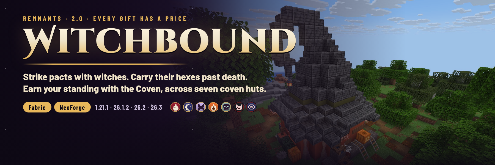
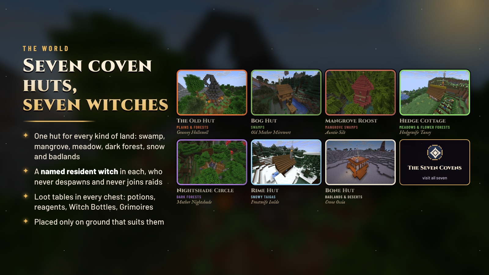
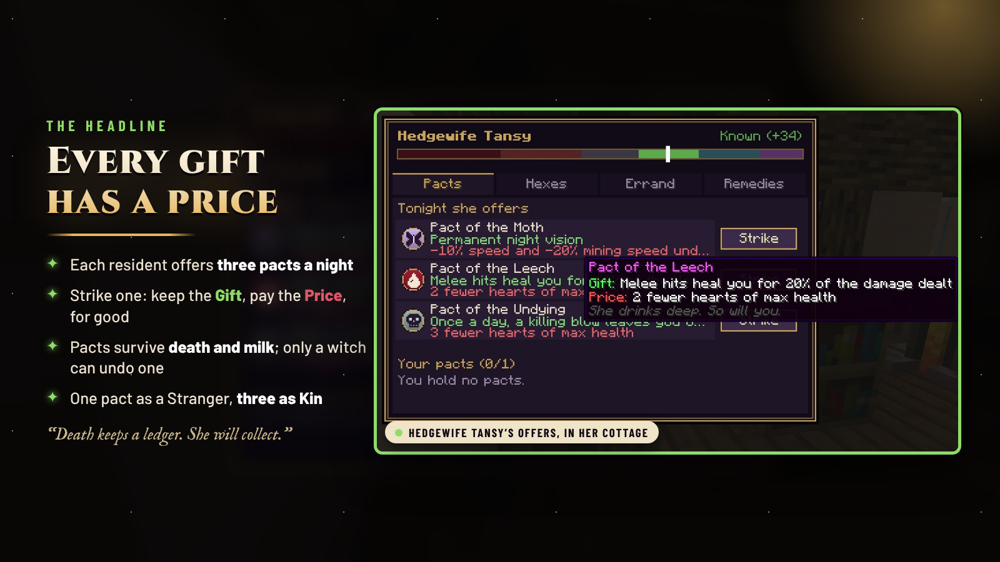
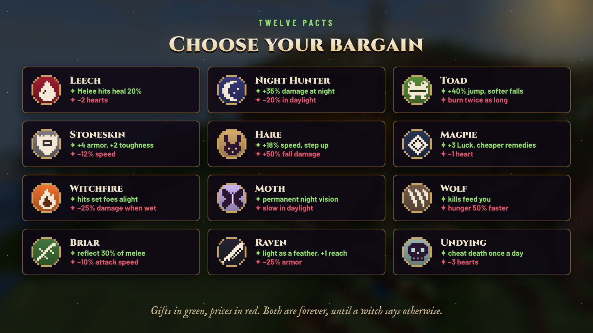
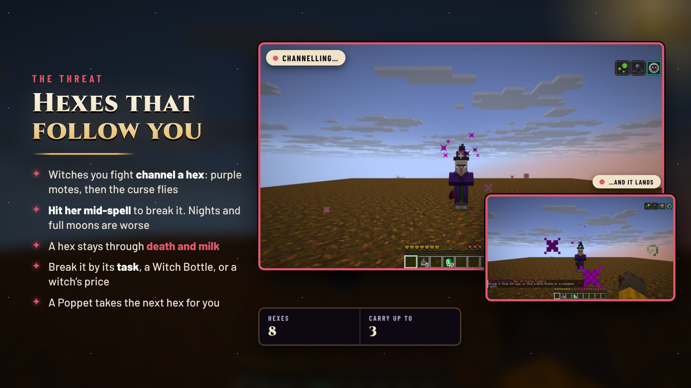
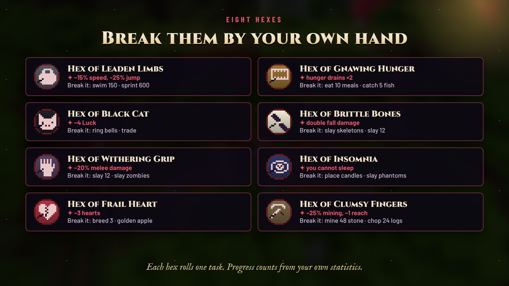
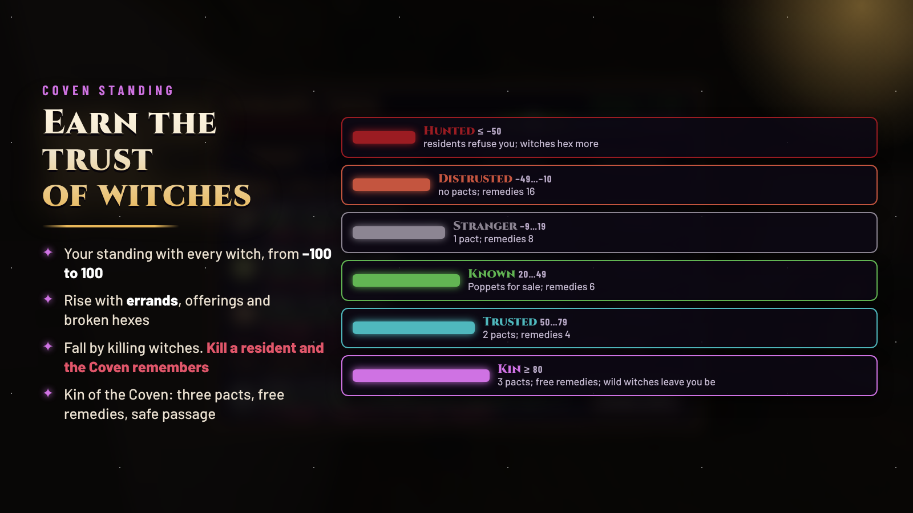
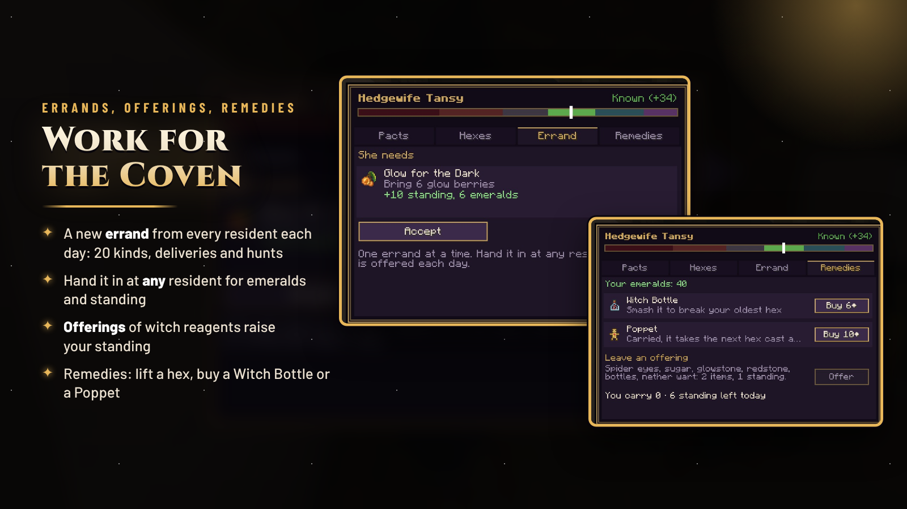
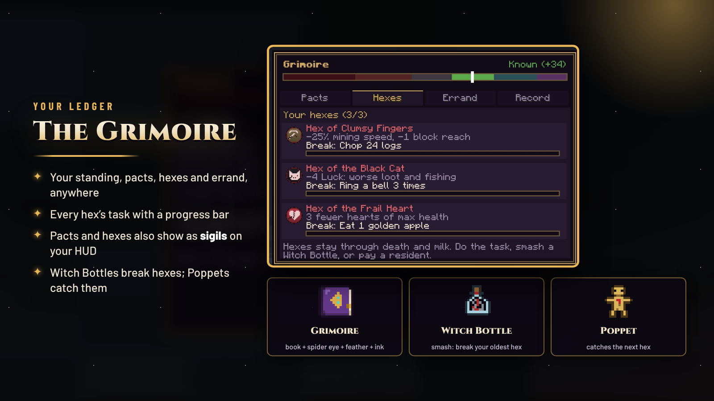
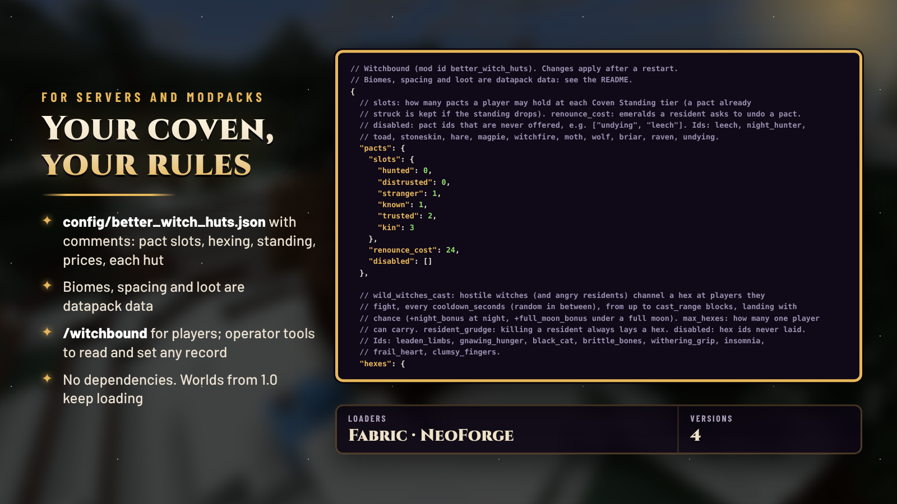

**[Discord](https://discord.gg/TJc3CxR4jK) · [Source and issues](https://github.com/MeherBenSalem/the-witch-hut)**

## Every gift has a price

**Remnants | Witchbound** makes Minecraft's witches an RPG faction you earn standing with. A resident witch in each of
seven coven huts offers **pacts**: keep the gift, pay the price, for good. Witches you fight channel **hexes** that
follow you past death until you break them. Your **Coven Standing** opens more pact slots and cheaper remedies, and at
the top, safe passage among witches.

Fabric and NeoForge · Minecraft 1.21.1, 26.1.2, 26.2 and 26.3 · install on the server and clients · Fabric needs Fabric API,
nothing else is needed

**2.0 "Every Gift Has a Price"** is a full rework of *The Witch Hut*. The mod id is the same and the original hut is
still here, repaired, so 1.0 worlds keep loading.

Version 2.0 rebuilds the mod around three RPG systems. Changes from 1.0:

- **Seven coven huts** instead of one, each with a **named resident witch**. The 1.0 hut is back as *The Old Hut*, with
  real loot.
- **12 pacts**: permanent gifts with permanent prices, such as Leech, Night Hunter, Witchfire and Undying.
- **8 hexes** cast by witches in battle. They survive death and milk, and you break them by doing their task.
- **Coven Standing** from −100 to 100, in six tiers from Hunted to Kin.
- **Errands, offerings and remedies** at every resident.
- **The Coven screen** and the **Grimoire** ledger. Pacts and hexes show as sigils on your HUD.
- **Witch Bottles** and **Poppets**.
- Wild witches **channel hexes**. Hit them mid-spell to break it.
- A 25-advancement tab, a commented config, `/witchbound` commands.
- Terrain-aware hut placement, **1.21.1** and **26.3** builds, and **no dependencies**. 1.0 needed an undeclared
  library.

| Hut | Where | Resident | What is there |
|---|---|---|---|
| The Old Hut | plains, sunflower plains, forests, birch forests | Granny Hollowell | the 1.0 tower under its witch-hat roof, repaired, with a brewing stand where the spawner was |
| Bog Hut | swamps | Old Mother Mirewort | a crooked hut on stilts with a jetty, a mossy chimney and a toadstool island |
| Mangrove Roost | mangrove swamps | Auntie Silt | a two-storey round tower on mangrove roots with a wraparound balcony |
| Hedge Cottage | meadows, flower forests, cherry groves | Hedgewife Tansy | a thatched cottage, a hedged herb garden, berry rows and beehives |
| Nightshade Circle | dark forests, pale gardens | Mother Nightshade | standing stones around a great cauldron on a blackstone dais, soul fires and candles |
| Rime Hut | snowy taigas, snowy plains, groves | Frostwife Isolde | a half-buried log cabin with a powder-snow cauldron and an ice altar |
| Bone Hut | badlands, deserts | Crone Ossia | terracotta and bone, a ribcage door, skulls on poles, a lava cauldron |

Residents never despawn, never join raids, and fight just if you strike them or if the Coven hunts you. Every chest has
its own loot table: potions, reagents, Witch Bottles, Grimoires and the odd Poppet.

Before a hut is placed, the land is sampled. Land huts need level ground, and swamp huts need shallow water or mud. Find
all seven for **The Seven Covens** advancement, or try `/locate structure #better_witch_huts:coven_huts`.

- Right-click a resident witch. Each night she offers **three pacts**, chosen for you and the same until the next day.
- **Strike** one and it is yours: its **Gift** and its **Price** are permanent.
- Pacts survive **death and milk**. A resident, and nobody else, can undo one, for 24 emeralds and a little standing.
- You hold **one pact** as a Stranger, **two** when Trusted and **three** as Kin.

| Pact | Gift | Price |
|---|---|---|
| Leech | melee hits heal you for 20 % of the damage | 2 fewer hearts |
| Night Hunter | +35 % melee damage at night and underground | −20 % under the daytime sky |
| Toad | jump 40 % higher, fall damage starts 6 blocks later | you burn twice as long |
| Stoneskin | +4 armor, +2 toughness | −12 % speed |
| Hare | +18 % speed, step up full blocks | +50 % fall damage |
| Magpie | +3 Luck, remedies cost a quarter less | 1 fewer heart |
| Witchfire | melee hits set targets on fire for 4 s | −25 % melee damage while wet |
| Moth | permanent night vision | −10 % speed and −20 % mining speed under the daytime sky |
| Wolf | every kill restores 2 hunger | hunger drains 50 % faster |
| Briar | melee attackers take 30 % of their damage back | −10 % attack speed |
| Raven | lighter gravity, softer landings, +1 reach | −25 % armor |
| Undying | once a day, a killing blow leaves you on 2 hearts with Regeneration | 3 fewer hearts |

- Witches you fight **channel a hex**: purple motes circle the witch for a moment, then the curse flies if she can still
  see you.
- **Hit her mid-spell** to break it. Nights are worse, and full moons are worse still.
- A hex stays through **death and milk**. You can carry up to three.
- **Break it** in one of three ways:
  - do the task it rolled
  - smash a **Witch Bottle**
  - pay a resident to lift it
- A **Poppet** in your inventory catches the next hex meant for you, then burns.
- Kill a resident and you get a hex every time. *The Coven will remember.*

| Hex | What it does | Break it by (one is rolled) |
|---|---|---|
| Leaden Limbs | −15 % speed, −25 % jump | swimming 150 blocks · sprinting 600 blocks |
| Gnawing Hunger | hunger drains twice as fast | eating 10 meals · catching 5 fish |
| Black Cat | −4 Luck | ringing a bell 3 times · trading 3 times |
| Brittle Bones | double fall damage | slaying 3 skeletons · slaying 12 creatures |
| Withering Grip | −20 % melee damage, −10 % attack speed | slaying 12 creatures · slaying 6 zombies |
| Insomnia | you cannot sleep | placing 6 candles · slaying 2 phantoms |
| Frail Heart | 3 fewer hearts | breeding 3 animals · eating a golden apple |
| Clumsy Fingers | −25 % mining speed, −1 reach | mining 48 stone · chopping 24 logs |

Progress comes from your own statistics, so it also counts what you do with other mods.

| Tier | Standing | What it means |
|---|---|---|
| Hunted | −50 or less | residents refuse you and fight; wild witches hex you more often |
| Distrusted | −49 to −10 | no pacts; lifting a hex costs 16 emeralds |
| Stranger | −9 to 19 | 1 pact; lifting costs 8 |
| Known | 20 to 49 | Poppets for sale; lifting costs 6 |
| Trusted | 50 to 79 | 2 pacts; lifting costs 4 |
| Kin | 80 or more | 3 pacts; free remedies; **wild witches leave you alone** |

**Raising your standing:**
- Errands: +8 to +15
- Offerings: up to +6 a day
- Breaking a hex by its task: +3

**Losing it:**
- Killing a witch: −4 (raid witches don't count)
- Striking a resident: −5
- Killing one: −40, and a hex

- **Errands:** every resident offers a new one each day, from 20 kinds:
  - deliveries: spider eyes, toadstools, phantom membranes, amethyst…
  - hunts: drowned, creepers, endermen, the illagers who burned the old covens…

  Hand it in at **any** resident for emeralds and standing, and sometimes a Witch Bottle.
- **Offerings:** give a witch the reagents witches carry (spider eyes, sugar, glowstone, redstone, bottles, nether
  wart). Every 2 items earn 1 standing.
- **Remedies:** lift a hex, buy a Witch Bottle (6 emeralds), or buy a Poppet (10 emeralds, from Known).

| Item | Recipe | What it does |
|---|---|---|
| Grimoire | book + spider eye + feather + ink sac (shapeless) | your ledger anywhere: standing, pacts, hexes with progress, errand, record |
| Witch Bottle | glass bottle + 2 iron nuggets + sweet berries + redstone (shapeless) | right-click to smash it and break your oldest hex |
| Poppet | string, wheat and an amethyst shard | carried, it catches the next hex cast at you |

Pacts and hexes also appear among your status effects as hand-drawn sigils, so you always see what you carry.

- `config/better_witch_huts.json` is written at startup, with comments. It controls:
  - pact slots per tier
  - hex chances, cooldowns and limits
  - every standing change
  - every price
  - Kin peace
  - each hut on or off
  - disabled pacts and hexes
- Biomes, spacing and loot are datapack data under `data/better_witch_huts/`.
- `/witchbound` shows your record. Operators get `/witchbound info|standing|pact|hex|errand <player>` for quests,
  servers and testing.
- The mod uses no custom networking: the Coven screen runs on vanilla container packets.
- It works alongside YUNG's Better Witch Huts and other swamp-hut mods, which change the vanilla hut. Witchbound adds
  its own.

Pick the file that matches **both** your Minecraft version and your loader:

| Minecraft | Fabric (needs Fabric API) | NeoForge |
|---|---|---|
| 1.21.1 | `better_witch_huts-fabric-1.21.1-2.0.0.jar` | `better_witch_huts-neoforge-1.21.1-2.0.0.jar` (NeoForge 21.1.219+) |
| 26.1.2 | `better_witch_huts-fabric-26.1.2-2.0.0.jar` | `better_witch_huts-neoforge-26.1.2-2.0.0.jar` (NeoForge 26.1.2.7-beta+) |
| 26.2 | `better_witch_huts-fabric-26.2-2.0.0.jar` | `better_witch_huts-neoforge-26.2-2.0.0.jar` (NeoForge 26.2.0.93+) |
| 26.3 | `better_witch_huts-fabric-26.3-2.0.0.jar` | `better_witch_huts-neoforge-26.3-2.0.0.jar` (NeoForge 26.3.0.97+) |

Java 21 for 1.21.1, 25 for 26.x.

**Do I need it on the server and the client?** Yes, on both.

**Will my 1.0 world break?** No. The mod id and the hut's structure id are unchanged. Huts that already generated stay,
and new chunks get the new huts.

**Can I lose a pact or a hex by dying or drinking milk?** No. Pacts end just when a resident undoes them. Hexes end
when you do their task, smash a Witch Bottle or pay a resident.

**The witches are too dangerous / not dangerous enough.** Change the hex chance, cooldown and limit in the config, or
turn hex-casting off for wild witches entirely.

**Is there a 1.21.1 version?** Yes, for Fabric and NeoForge, with the same content as the 26.x builds.

**Can I use it in my modpack?** Yes. It is Apache-2.0, has no dependencies and has commands for quest mods.

- **Witch variants:** bog, frost, bone and ash witches with their own brews and hexes.
- **The Sabbath:** on full moons the Coven gathers at the Nightshade Circle.
- **Herbalism:** wild mandrake, wolfsbane and nightshade for home-brewed remedies.
- **Familiars:** small companions that grow with your standing.

---

> **Play it in [Remnants: Ashen Legacy](https://www.curseforge.com/minecraft/modpacks/remnants-ashen-legacy)**, NightBeam's story-driven soulslike RPG modpack. It builds Witchbound into one rule set with the rest of the Remnants series.

---

### More from NightBeam Studio

- **[Remnants: Ashen Legacy](https://www.curseforge.com/minecraft/modpacks/remnants-ashen-legacy)**: the story-driven soulslike RPG modpack built on NightBeam's mods
- **[Premium server plugins](https://nightbeam.dev/store)**: anti-cheat, ranked PvP, SMP setups and more on BuiltByBit
- **[NightBeam Pro](https://nightbeam.dev/memberships)**: the model library and NightBeam Forge credits, from $5 a month
- **[Discord](https://discord.gg/TJc3CxR4jK)**: support, bug reports, suggestions and early looks
- **[Support NightBeam](https://nightbeam.dev/support)**: help keep every mod free

**Follow:** [YouTube](https://www.youtube.com/@nightbeamstudio) · [Instagram](https://www.instagram.com/nightbeamstudio/) · [X](https://x.com/NightBeamLLC) · [Facebook](https://www.facebook.com/profile.php?id=61574823331471)
